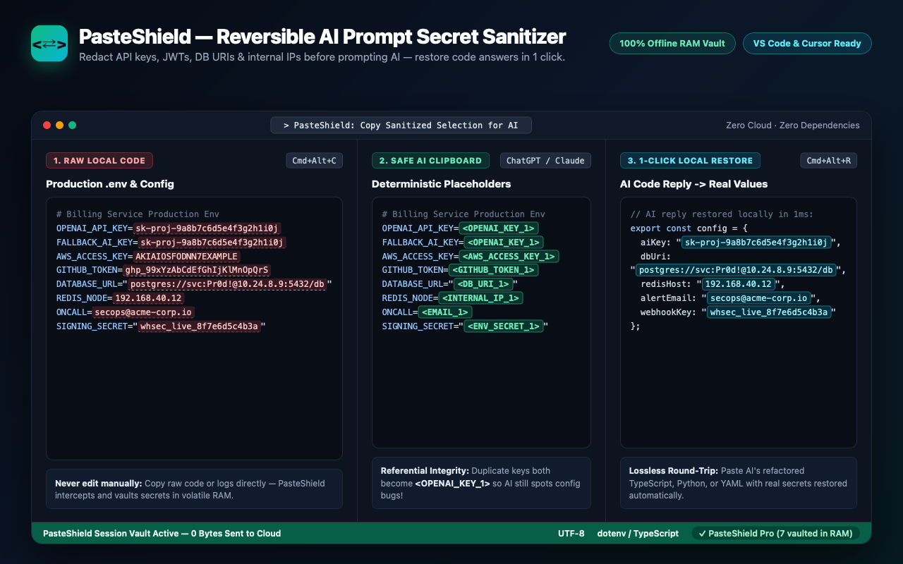
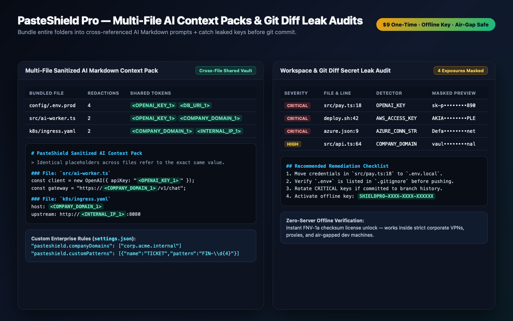
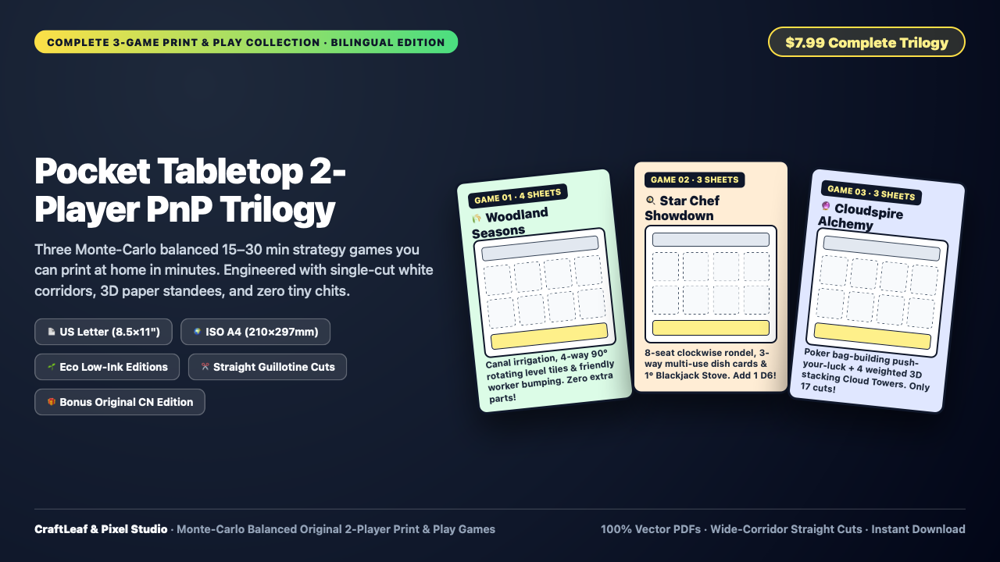

# 🌿 CraftLeaf & Pixel Studio · 青叶像素独立工坊

**100% Client-Side Privacy-First Browser Micro-Tools, Freemium Developer Extensions, Solo-Founder Templates & Original 2-Player Print-and-Play Tabletop Games**

*文件绝不上传云端 · 免注册打开即用 · 零遥测编辑器与浏览器扩展 · 原创双人打印即玩策略桌游*

---

## 🚀 1-Click Live Browser Studios (Zero Upload · Zero Signup)

All image cropping, PDF rendering, invoice math, and duplex card alignment execute **100% locally in your browser memory**. Sensitive ID photos and client ledgers never touch any server.

| Studio / 工具台 | Live Launch Badge | Core Capabilities / 核心亮点 |
| :--- | :---: | :--- |
| **🪪 Passport & Visa ID Photo 4×6" Sheet Studio** *出国护照 / 美签 / 申根证件照 4×6 寸冲印拼版器* |  | Crop **US 2×2"**, **Schengen 35×45mm**, **UK**, **Canada 50×70mm**, **Japan**, **China 33×48mm** visa photos with biometric head/chin guides and tile onto a `$0.39` drugstore 4×6" sheet. |
| **🧾 No-Signup Freelancer Invoice & Receipt Studio** *免注册多币种英文 / 双语商业发票与收据生成器* |  | Generate crisp A4 / US Letter vector PDFs in 30s with multi-currency tax & discount calculation, local client CRM memory, custom brand colors, and payment QR codes. |
| **🗂️ CardSheet & Flashcard Duplex Print Studio** *单词闪卡 / 名片 / 桌游卡牌双面毫米级校准拼版台* |  | Paste TSV/CSV vocab lists or drag card images onto A4 / US Letter sheets with **millimeter front-to-back printer offset calibration** and straight guillotine cut guides. |
| **📚 60+ Print Specs, Visa Sizes & Templates Hub** *各国签证照片尺寸标准与打印排版指南中心* |  | Country-by-country passport & visa biometric dimension charts, freelance invoice checklists, and printable flashcard layout guides. |

---

## 🛡️ Developer & Browser Extensions (Zero Telemetry · Freemium)

### 1. PasteShield — Reversible AI Prompt & Clipboard Secret Sanitizer (VS Code, Cursor & CLI)

Stop leaking `.env` secrets, OpenAI/Anthropic keys, AWS/GitHub tokens, JWTs, database URIs, PEM private keys, and internal corporate IPs into ChatGPT, Claude, Cursor, or Copilot. PasteShield maps secrets in local RAM to deterministic semantic tokens (`<OPENAI_KEY_1>`, `<DB_URI_1>`) and **restores real values in 1 click** (`Cmd+Alt+C` → prompt LLM → `Cmd+Alt+R`).

-   [-GitHub_Release-10b981?style=flat-square)](https://github.com/963239327/pasteshield-secret-sanitizer/releases/latest/download/pasteshield-ai-secret-sanitizer-1.1.1.vsix) 

  
  

### 2. CleanPrint & AI-Chat to PDF Studio (Microsoft Edge, Chrome, Brave & Firefox)

Purify cluttered web articles and long **ChatGPT / Claude / Copilot / DeepSeek / GitHub** threads into publication-grade, ink-saving vector PDFs. Prevents chopped-off code blocks across page breaks and saves up to **65% black toner** with Eco Low-Ink mode.

-    

---

## 💼 Solo-Founder Finance, SaaS Bleed & Tax OS (`$0` Free Starter Kit)

An offline-first financial command center built for freelancers, indie hackers, and one-person businesses (*一人公司与自由职业财务、订阅止损及 AI 提效管家*):
- **Try Live Sandbox in Browser:** [SaaS Subscription Bleed & Reverse Hourly Rate Calculator →](https://963239327.github.io/craftleaf-studio/templates/)
- **1-Click `$0` Free Starter Kit Download:** [-10b981?style=flat-square)](https://stardustdemo.gumroad.com/l/solofounder-starter-kit) *(includes offline HTML Pricing Calculator Lite, SaaS Bleed Audit CSV & 10 Commercial AI Prompts Quickstart)*
- **Upgrade to Complete Offline Pro OS ($9.99):** Full interactive HTML Finance & Schedule-C Tax Dashboard, 5 bilingual EN/ZH ledgers & CRM spreadsheets, Anti-Scope-Creep SOW templates, and the complete AI Automation SOP Playbook → [Explore Pro Edition](https://963239327.github.io/craftleaf-studio/templates/#pro-pack)

---

## 🎲 Original 2-Player Print & Play Tabletop Games (7 Bilingual Titles) + Browser AI Game

Seven Monte-Carlo-balanced, tactile 2–4 sheet strategy board games crafted for ISO A4, North American US Letter (`8.5×11"`), and Eco Low-Ink home printing (*7 款原创中英双语双人打印即玩微桌游：三部曲 + 2 页扑克双人对决四重奏*):

  

1. **🍳 Star Chef Showdown: Rondel Bistro (`《星厨对决》` v0.7.9)** — 8-seat clockwise rondel movement × multi-use dish cards × 1° Blackjack wok push-your-luck heat control (18★ endgame).
   - **[▶ Play Solo vs. Sous-Chef AI in Your Browser (Free HTML5)](https://963239327.github.io/craftleaf-studio/play/)** · **[Download Free Sample PDF](https://963239327.github.io/craftleaf-studio/games/previews/star_chef_sample_preview.pdf)**
2. **🌾 Woodland Seasons: Emerald Valley (`《四季森友》` v0.8.10)** — Friendly-bump worker placement across an 8-solar-term clock, 24 four-way rotating habitat tiles, stone canals & 12 symbiotic woodland critters.
   - **[Download Free Sample PDF](https://963239327.github.io/craftleaf-studio/games/previews/woodland_seasons_sample_preview.pdf)**
3. **🔮 Cloudspire Alchemy: Skyward Grimoires (`《云塔炼金》` v0.7.5)** — Pair 3 printed sheets (including foldable weighted **3D paper cloud towers**) with any standard 54-card poker deck for tense grimoire engine building.
   - **[Download Free Sample PDF](https://963239327.github.io/craftleaf-studio/games/previews/cloudspire_alchemy_sample_preview.pdf)**
4. **⛵ Tidal Trade League: Archipelago Routes (`《潮汐商盟》` v0.3.3 · 2 Sheets + Poker Deck)** — Harbor wholesale loading, live commodity market crash & monopoly contracts.
   - **[Download Free Sample PDF](https://963239327.github.io/craftleaf-studio/games/previews/tidal_trade_league_sample_preview.pdf)**
5. **🏛️ Duchy of Firenze: Renaissance Guilds (`《翡冷翠公国》` v0.2.5 · 2 Sheets + Poker Deck)** — 3-Age `3-4-5` open-/hidden-row pyramid draft with instant military, guild & prestige victories.
   - **[Download Free Sample PDF](https://963239327.github.io/craftleaf-studio/games/previews/duchy_of_firenze_sample_preview.pdf)**
6. **🚀 Stargate Jump: Deep Space Epoch (`《星门跃迁》` v0.3.5 · 2 Sheets + Poker Deck)** — Simultaneous `A–5` Command Order phase selection with 1-round cooldown lock & `3×3` Starmap colonization.
   - **[Download Free Sample PDF](https://963239327.github.io/craftleaf-studio/games/previews/stargate_jump_sample_preview.pdf)**
7. **🏺 Grand Curio Museum: Time-Track Curators (`《万象博物院》` v0.2.5 · 2 Sheets + Poker Deck)** — Non-alternating 20-step Time Corridor (`Trailing Curator Always Acts`) & `3×3` dual-axis gallery curation.
   - **[Download Free Sample PDF](https://963239327.github.io/craftleaf-studio/games/previews/grand_curio_museum_sample_preview.pdf)**

👉 **Explore the 2-Page Poker Quartet Guide:** [English Deep-Dive Guide](https://963239327.github.io/craftleaf-studio/seo/2-page-poker-deck-print-and-play-board-games-for-2-players.html) · [中文图解指南](https://963239327.github.io/craftleaf-studio/cn-guides/2-page-poker-deck-2-player-print-and-play-board-games-zh.html)
👉 **Designing your own board game?** Check out the **[Tabletop PnP HTML-to-PDF & 10,000-Run Monte Carlo Creator Kit ($12.99)](https://963239327.github.io/craftleaf-studio/#creator-kit)** (dual A4/Letter CSS print framework, 3D standee/tower die-cuts, 60 commercial-free SVG icons & Python balance simulator).

---

## 📦 Summary of Latest Official Downloads & Free Samples

| Asset | Type | Direct Download |
| :--- | :--- | :--- |
| `pasteshield-ai-secret-sanitizer-1.1.1.vsix` | VS Code / Cursor / Windsurf Extension (`v1.1.1`) | [Download `.vsix`](https://github.com/963239327/pasteshield-secret-sanitizer/releases/latest/download/pasteshield-ai-secret-sanitizer-1.1.1.vsix) |
| `cleanprint-studio-edge-chromium-v1.1.0.zip` | Edge / Chrome / Brave Extension (`v1.1.0`) | [Download `.zip`](https://github.com/963239327/cleanprint-ai-chat-to-pdf/releases/latest/download/cleanprint-studio-edge-chromium-v1.1.0.zip) |
| `cleanprint-studio-firefox-amo-v1.1.0.zip` | Mozilla Firefox Extension (`v1.1.0`) | [Download `.zip`](https://github.com/963239327/cleanprint-ai-chat-to-pdf/releases/latest/download/cleanprint-studio-firefox-amo-v1.1.0.zip) |
| `SoloFounder_OS_FREE_Starter_Kit.zip` | `$0` Solo-Founder Finance & AI Starter Pack | [Get Free on Gumroad](https://stardustdemo.gumroad.com/l/solofounder-starter-kit) |
| `star_chef_sample_preview.pdf` | 1-Page Watermarked PnP Sample (`v0.7.9`) | [Open `.pdf`](https://963239327.github.io/craftleaf-studio/games/previews/star_chef_sample_preview.pdf) |
| `woodland_seasons_sample_preview.pdf` | 1-Page Watermarked PnP Sample (`v0.8.10`) | [Open `.pdf`](https://963239327.github.io/craftleaf-studio/games/previews/woodland_seasons_sample_preview.pdf) |
| `cloudspire_alchemy_sample_preview.pdf` | 1-Page Watermarked PnP Sample (`v0.7.5`) | [Open `.pdf`](https://963239327.github.io/craftleaf-studio/games/previews/cloudspire_alchemy_sample_preview.pdf) |
| `tidal_trade_league_sample_preview.pdf` | 1-Page Watermarked 2-Sheet Poker Sample (`v0.3.3`) | [Open `.pdf`](https://963239327.github.io/craftleaf-studio/games/previews/tidal_trade_league_sample_preview.pdf) |
| `duchy_of_firenze_sample_preview.pdf` | 1-Page Watermarked 2-Sheet Poker Sample (`v0.2.5`) | [Open `.pdf`](https://963239327.github.io/craftleaf-studio/games/previews/duchy_of_firenze_sample_preview.pdf) |
| `stargate_jump_sample_preview.pdf` | 1-Page Watermarked 2-Sheet Poker Sample (`v0.3.5`) | [Open `.pdf`](https://963239327.github.io/craftleaf-studio/games/previews/stargate_jump_sample_preview.pdf) |
| `grand_curio_museum_sample_preview.pdf` | 1-Page Watermarked 2-Sheet Poker Sample (`v0.2.5`) | [Open `.pdf`](https://963239327.github.io/craftleaf-studio/games/previews/grand_curio_museum_sample_preview.pdf) |

---

## 🔑 Studio All-Access Lifetime Pro Pass ($19 / ¥69)

One **CraftLeaf All-Access Gumroad License Key** permanently unlocks Pro tiers across **all 5 CraftLeaf tools** (`IDPhoto 4×6 Studio`, `Freelancer Invoice CRM`, `CardSheet Duplex Batch Aligner`, `CleanPrint Browser Extension`, and `PasteShield for VS Code, Cursor & CLI/MCP`) — **one-time purchase, zero recurring subscriptions, zero user data uploaded**.

👉 **[Unlock Studio All-Access Pass →](https://963239327.github.io/craftleaf-studio/#all-access)**

---

## 🔒 Privacy Guarantee (隐私承诺)

- **0 Bytes Uploaded:** Photos, invoices, flashcards, web pages, and code secrets never leave your device.
- **0 Accounts / Tracking:** Instant browser & offline execution with cryptographically verified local Pro keys.
